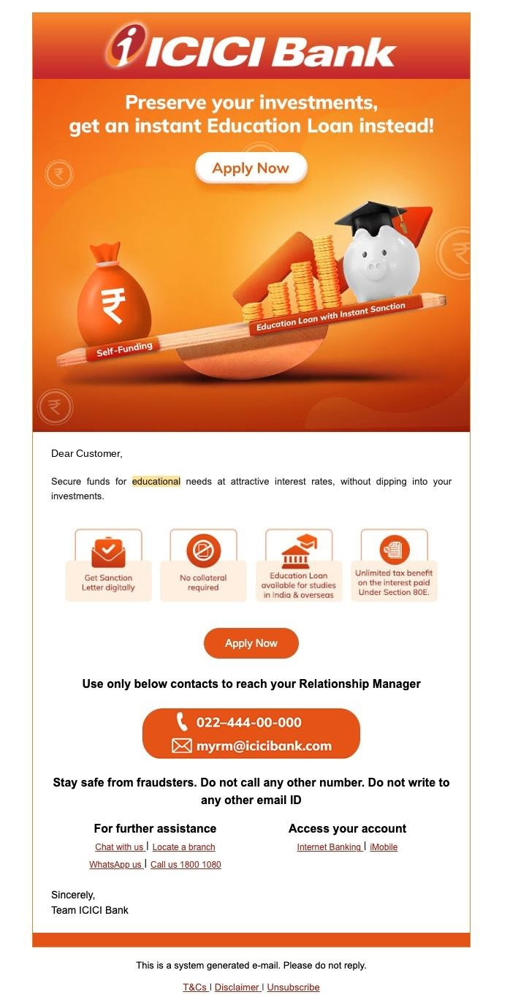
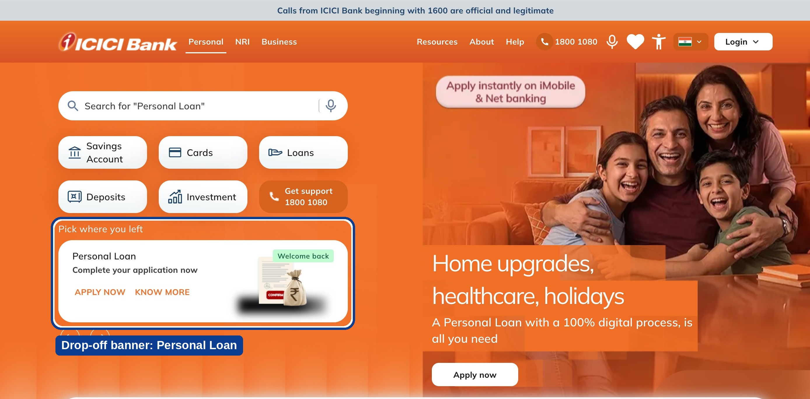
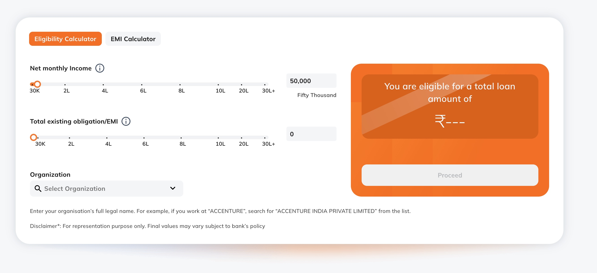
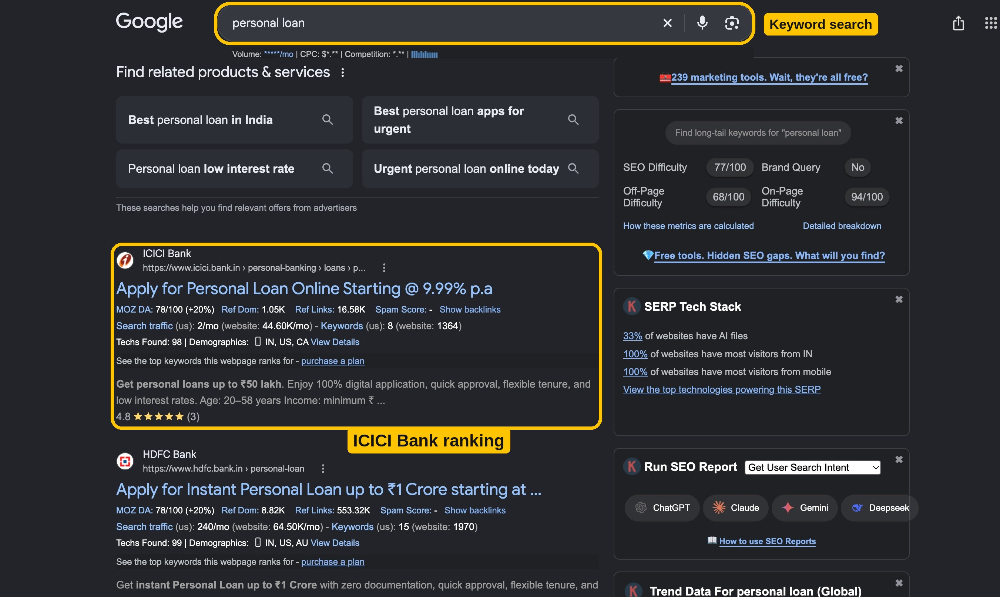

# Kanika Dhingra | Work Portfolio

**Portfolio Strategy & Lifecycle Marketing Manager** | Digital Lending | Bengaluru

I run lifecycle marketing for consumer lending, from acquisition to win-back, using segmentation, testing and analytics. 7+ years across banking and NBFC, currently Chief Manager, Product Marketing at ICICI Bank.

- **₹400 → ₹700 Cr:** digital lending portfolio growth, to which I contributed through digital marketing levers
- **₹10 Cr:** cumulative business impact from campaigns and journey fixes
- **4 products:** education, personal, salary overdraft and business instalment loans
- **Full lifecycle:** acquisition, conversion, engagement and retention

## Lifecycle Coverage

| Stage | What I did | Result |
|---|---|---|
| Acquisition | Keyword and content strategy, product page updates | Landing page 7th → 3rd on Google; 5 keywords in top 10 |
| Conversion | Eligibility calculator; drop-off banner | 80%+ CTR; 10% of banner clickers completed applications |
| Engagement | Segment-targeted email; notifications and banners | 30% open rate, 5% CTR; ₹1 Cr impact |
| Retention | Win-back outbound campaign | 30% of at-risk value recovered |

## Case Study 1: Targeted Education Loan Email

**Problem.** High-value customers with strong savings were likely to fund education by breaking their investments.

**Action.** I defined the segment (aged 40–60, parents, strong credit, pre-approved offer) and owned targeting, offer, creative brief, journey and measurement. The message set self-funding against an instant loan: *"Preserve your investments, get an instant Education Loan instead."*

**Result.** 30% open rate | 5% click-through rate

## Case Study 2: "Pick where you left" Drop-off Banner

**Problem.** Customers were starting Personal Loan applications and abandoning them.

**Action.** I launched a homepage banner shown when a customer drops off the application journey. The card reads "Personal Loan – Complete your application now" with Apply Now and Know More buttons.

**Result.** 10% of customers who clicked the banner completed their application.

## Case Study 3: Eligibility Calculator

**Problem.** Competitor benchmarking showed where we were losing customers in acquisition and activation.

**Action.** I identified an eligibility calculator as a high-performing intervention. It shows customers their maximum loan eligibility based on FOIR (Fixed Obligation to Income Ratio), so they apply with confidence, and it helps the bank win higher-value applications. I scaled it across additional product lines with policy, IT and design teams.

**Result.** 80%+ click-through rate

## Case Study 4: Organic Search

**Problem.** High-intent searches such as "personal loan" average about 3,00,000 searches a month, a large organic opportunity for our product pages.

**Action.** I identified high-volume keywords, built content around them and kept product pages updated.

**Result.** Landing page moved from 7th to 3rd, with 5 high-intent keywords in the top 10.

## More Impact

- **Win-back:** an outbound-calling campaign recovered 30% of at-risk portfolio value after an 80% engagement decline.
- **Journey fixes:** pop-up banners and journey redesign lifted application and activation rates by 5%.
- **Lifecycle automation:** activity-triggered lending offers drove a 3% business lift; targeted campaigns grew conversion 5% across four products.
- **Engagement features:** bell notifications, banners and SEM-driven tools for drop-off segments delivered ₹1 Cr impact.
- **Chai Point:** onboarding and delivery redesign cut churn from 15% to 2% and delivery time by 61%; "Deal of the Day" lifted repeat orders by 50%.

## Content

- **Video:** [ICICI Bank Salary Overdraft FlexiCash | Explained | Quick Guide](https://youtu.be/XdD5XEWqMk0?si=q71OOmv2H5ra0b9W)
- **Blog:** [Important facts about personal loan foreclosure](https://www.icici.bank.in/personal-banking/blogs/loan/personal-loan/important-facts-personal-loan-foreclosure)
- **Landing page:** [Personal Loan](https://www.icici.bank.in/personal-banking/loans/personal-loan?ITM=nli_loans_loans_na_entrypoints_1_CMS_personalLoan_NLI)

## Tools

Adobe Analytics, Adobe Campaign, Adobe Target, CleverTap, MoEngage, Tableau, JIRA

## Contact

Kanika Dhingra | Bengaluru | dhingra.kanika95@gmail.com | +91 9910189732
